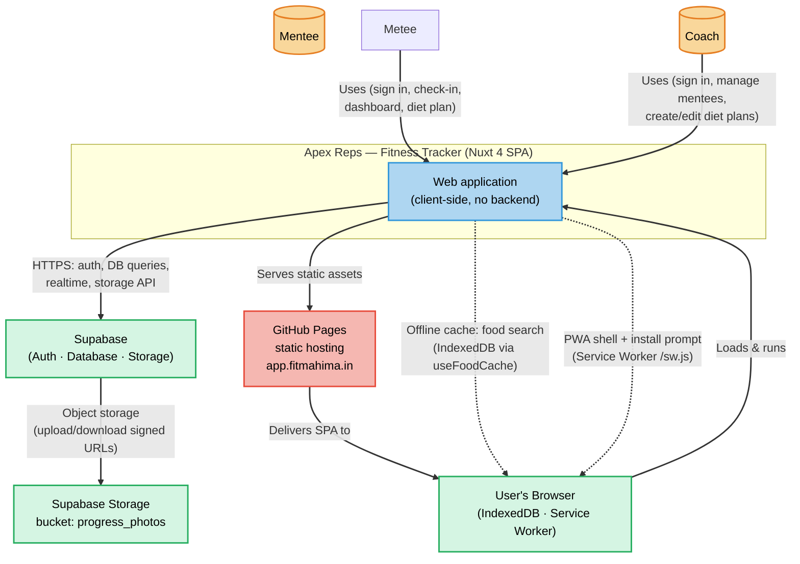

# C4 Level 1 — System Context

Shows the **Apex Reps** system, the people who use it, and the external systems it depends on.

## Summary

| Element          | Description                                                                                                                                           |
| ---------------- | ----------------------------------------------------------------------------------------------------------------------------------------------------- |
| **Mentee**       | End client of Mahima Srivastava. Logs body measurements + progress photos, views trends, tracks assigned diet plan.                                   |
| **Coach**        | Mahima Srivastava (or staff). Creates/edits/deletes diet plans for mentees, views mentee progress.                                                    |
| **Apex Reps**    | Single-page application (Nuxt 4, `ssr: false`) with no custom backend. All data lives in Supabase.                                                    |
| **Supabase**     | Backend-as-a-service providing Auth (GoTrue), PostgreSQL database, and object storage. Reached directly from the browser via `@supabase/supabase-js`. |
| **GitHub Pages** | Static site host for the production build (`nuxt generate`). Custom domain `app.fitmahima.in`.                                                        |

## Key boundaries

- **No backend code in this repo.** The SPA talks directly to Supabase; Row Level Security (RLS) enforces access control at the database layer.
- **Auth cookies/tokens** live in the browser; every Supabase call carries the user's JWT (see `app/utils/supabase.ts`).
- **Photos** are stored in a private Supabase bucket and read via short-lived signed URLs (7-day expiry).
- **Offline support** is limited to food-search caching in IndexedDB and a PWA service-worker shell — check-ins and diet-plan writes require network.
