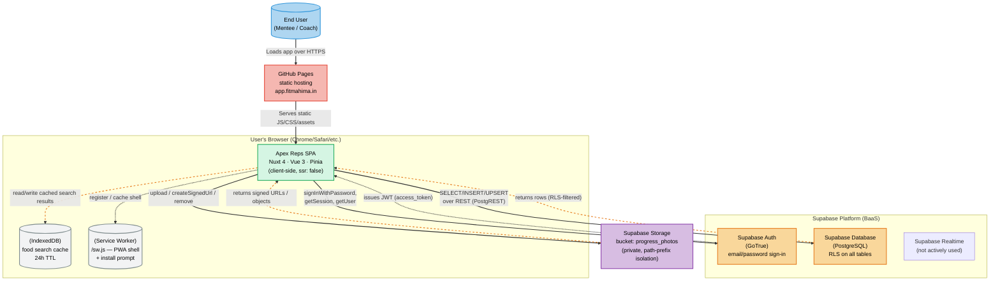

# C4 Level 2 — Container

Shows the high-level technical building blocks and how they communicate.

## Container responsibilities

| Container             | Technology             | Responsibility                                                                                                                      |
| --------------------- | ---------------------- | ----------------------------------------------------------------------------------------------------------------------------------- |
| **GitHub Pages**      | Static site hosting    | Builds (`nuxt generate`) and serves the prerendered SPA at `app.fitmahima.in`.                                                      |
| **Apex Reps SPA**     | Nuxt 4 / Vue 3 / Pinia | UI, state management, data fetching, validation (Zod), image compression, BFP calculation, routing.                                 |
| **Supabase Auth**     | GoTrue                 | Email/password authentication, session management, JWT issuance.                                                                    |
| **Supabase Database** | PostgreSQL             | All application data (profiles, stats, photos, subscriptions, plans, food_items, diet_plans, …). RLS enforces per-user/role access. |
| **Supabase Storage**  | Object storage         | Private `progress_photos` bucket for progress images.                                                                               |
| **IndexedDB**         | Browser local          | `useFoodCache` — 24h TTL cache of food search results for offline use.                                                              |
| **Service Worker**    | `/sw.js`               | PWA offline shell + install prompt (composable `usePWA`).                                                                           |

## Data flow (typical check-in)

1. Browser loads SPA from GitHub Pages.
2. SPA calls Supabase Auth → session restored via JWT.
3. User submits check-in form (`/check-in`).
4. `statsStore.saveStatsAndPhotos()`:
   - Calculates BFP client-side (`bodyFat.ts`).
   - Compresses photos client-side (`image.ts`).
   - Inserts `stats` row → gets `statId`.
   - Uploads each photo to Supabase Storage (`progress_photos` bucket).
   - Inserts `photos` row per angle.
   - On any failure: rolls back stat row + removes uploaded objects.

## Security boundary

RLS policies live in the database, not the client. The SPA cannot bypass them — every request carries the user's JWT and Supabase evaluates policies server-side. See `ai-workspace/database/rls-policies.md`.
