# C4 Level 3 — Component (SPA Container)

Shows the components inside the **Apex Reps SPA** container: pages, layouts, middleware, stores, composables, utils, and UI components.

```mermaid
flowchart TB
    %% Styling classes
    classDef page fill:#aed6f1,stroke:#3498db,stroke-width:2px,color:#000
    classDef layout fill:#d5f5e3,stroke:#27ae60,stroke-width:2px,color:#000
    classDef store fill:#f9d79b,stroke:#e67e22,stroke-width:2px,color:#000
    classDef util fill:#d7bde2,stroke:#8e44ad,stroke-width:2px,color:#000
    classDef comp fill:#f2f3f4,stroke:#7f8c8d,stroke-width:2px,color:#000
    classDef compo fill:#fdebd0,stroke:#d68910,stroke-width:2px,color:#000
    classDef ext fill:#f5b7b1,stroke:#e74c3c,stroke-width:2px,color:#000

    %% App shell
    subgraph Shell["App Shell"]
        AppVue["app.vue<br/>UApp + NuxtLayout + NuxtPage"]
        DefaultLayout["layouts/default.vue<br/>header · logout · footer · BottomNav"]
        CoachLayout["layouts/coach.vue<br/>coach portal header + nav"]
        AuthMW["middleware/auth.global.ts<br/>requires auth except /login"]
    end

    %% Pages
    subgraph Pages["Pages (file-based routing)"]
        Login["pages/login.vue<br/>email/password login<br/>layout: false"]
        Index["pages/index.vue<br/>dashboard<br/>· subscription · stats · charts · photo compare"]
        CheckIn["pages/check-in.vue<br/>measurements + photos form"]
        DietPlan["pages/diet-plan.vue<br/>mentee diet plan tracker"]
        CoachDash["pages/coach/index.vue<br/>coach dashboard<br/>· mentees · plan stats"]
        CoachPlansList["pages/coach/diet-plans/index.vue<br/>list all plans"]
        CoachPlanNew["pages/coach/diet-plans/new.vue<br/>create new plan"]
        CoachPlanEdit["pages/coach/diet-plans/[id]/<br/>edit plan"]
    end

    %% Stores
    subgraph Stores["Pinia Stores (state + Supabase data access)"]
        AuthStore["stores/auth.ts<br/>fetchSession · login · logout"]
        ProfileStore["stores/profile.ts<br/>fetchProfile · fetchMyMentees"]
        StatsStore["stores/stats.ts<br/>fetchAllStats · fetchLeftPhotos ·<br/>saveStatsAndPhotos (transactional + rollback)"]
        SubStore["stores/subscription.ts<br/>fetchActiveSubscription"]
        PlanStore["stores/plan.ts<br/>fetchPlan"]
        DietPlanStore["stores/dietPlan.ts<br/>fetchPlanForDate · toggleConsumed · saveNotes<br/>· createPlan · updatePlan · deletePlan · fetchMentees ·<br/>fetchCoachPlans · fetchPlansForMentee · fetchPlanForEdit"]
        FoodStore["stores/foodItem.ts<br/>searchFoods · createCustomFood"]
    end

    %% Composables
    subgraph Composables["Composables"]
        FoodCache["composables/useFoodCache.ts<br/>IndexedDB food search cache (24h TTL)"]
        OnlineStatus["composables/useOnlineStatus.ts<br/>navigator.onLine reactivity"]
        PWA["composables/usePWA.ts<br/>service worker + install prompt"]
    end

    %% Utils
    subgraph Utils["Utils (pure functions / clients)"]
        SupabaseUtil["utils/supabase.ts<br/>getSupabase() — lazy Supabase client<br/>(optionally with user JWT)"]
        BodyFat["utils/bodyFat.ts<br/>calculateBodyFatPercentage()<br/>(US Navy method)"]
        ImageUtil["utils/image.ts<br/>compressImage()<br/>(1000px max · JPEG q=0.82)"]
        FoodMacros["utils/foodMacros.ts<br/>calculateMacros() · sumMacros()"]
        Constants["utils/constants.ts<br/>bucket name · allowed types ·<br/>buildPhotoStoragePath()"]
    end

    %% UI components
    subgraph UI["UI Components (@nuxt/ui + custom)"]
        BottomNav["components/BottomNav.vue<br/>mobile tabs: Dashboard · Check-in · Diet Plan"]
        PhotoUpload["components/PhotoUploadField.vue<br/>file input (jpeg/png)"]
        ProgressCompare["components/ProgressPhotoCompare.vue<br/>earlier vs latest left photo"]
        StatChart["components/StatChart.vue<br/>nuxt-charts line chart"]
        SubscriptionCard["components/SubscriptionCard.vue<br/>plan details or expired msg"]
        AppLogo["components/AppLogo.vue<br/>brand logo"]
        PageLoader["components/PageLoader.vue<br/>full-screen loader"]
        FoodSelector["components/diet-plan/FoodSelector.vue<br/>food autocomplete"]
        CustomFoodModal["components/diet-plan/CustomFoodModal.vue<br/>create custom food"]
    end

    %% External (Supabase)
    Supabase["Supabase<br/>(Auth · DB · Storage)"]:::ext

    %% Relationships: shell
    AppVue --> DefaultLayout
    AppVue --> CoachLayout
    DefaultLayout --> AuthMW
    CoachLayout --> AuthMW

    %% Relationships: pages -> stores
    Login --> AuthStore
    Index --> ProfileStore
    Index --> SubStore
    Index --> PlanStore
    Index --> StatsStore
    CheckIn --> StatsStore
    DietPlan --> AuthStore
    DietPlan --> ProfileStore
    DietPlan --> DietPlanStore
    CoachDash --> AuthStore
    CoachDash --> ProfileStore
    CoachDash --> DietPlanStore
    CoachPlansList --> DietPlanStore
    CoachPlanNew --> DietPlanStore
    CoachPlanEdit --> DietPlanStore

    %% Relationships: pages -> UI components
    Index --> ProgressCompare
    Index --> StatChart
    Index --> SubscriptionCard
    CheckIn --> PhotoUpload
    DietPlan --> FoodSelector
    DietPlan --> CustomFoodModal

    %% Relationships: stores -> supabase util
    AuthStore --> SupabaseUtil
    ProfileStore --> SupabaseUtil
    StatsStore --> SupabaseUtil
    SubStore --> SupabaseUtil
    PlanStore --> SupabaseUtil
    DietPlanStore --> SupabaseUtil
    FoodStore --> SupabaseUtil

    %% Relationships: stores -> utils / composables
    StatsStore --> BodyFat
    StatsStore --> ImageUtil
    StatsStore --> Constants
    DietPlanStore --> FoodMacros
    FoodStore --> FoodCache
    FoodStore --> OnlineStatus
    DefaultLayout --> PWA

    %% Relationships: stores cross-refs
    StatsStore -.-> ProfileStore
    DietPlanStore -.-> ProfileStore
    SubscriptionCard --> SubStore
    SubscriptionCard --> PlanStore

    linkStyle default stroke-width:1.5px,fill:none,stroke:#555
    linkStyle 26,27,28,29,30,31 stroke:#e67e22,stroke-width:2px
    linkStyle 34,35,36,37,38 stroke:#8e44ad
```

## Component responsibilities

| Layer             | Key elements                                              | Role                                                                                                                                                                    |
| ----------------- | --------------------------------------------------------- | ----------------------------------------------------------------------------------------------------------------------------------------------------------------------- |
| **App shell**     | `app.vue`, layouts, auth middleware                       | Bootstraps Nuxt, applies layout per route, guards unauthenticated access to all pages except `/login`.                                                                  |
| **Pages**         | `login`, `index`, `check-in`, `diet-plan`, `coach/*`      | Route-level UI; orchestrate store calls in `onMounted`; handle role-based redirects (coach → `/coach`, mentee → `/`).                                                   |
| **Stores**        | 7 Pinia stores                                            | Single source of truth for client state; every store talks to Supabase via `getSupabase()`. `statsStore` and `dietPlanStore` implement transactional insert + rollback. |
| **Composables**   | `useFoodCache`, `useOnlineStatus`, `usePWA`               | Cross-cutting concerns: offline food-cache, connectivity reactivity, PWA shell.                                                                                         |
| **Utils**         | `supabase`, `bodyFat`, `image`, `foodMacros`, `constants` | Pure/logic helpers reused by stores and components. `getSupabase()` is the single Supabase client factory.                                                              |
| **UI components** | 9 components                                              | Presentational + form UI built on `@nuxt/ui`; some have local store references (e.g., `SubscriptionCard`).                                                              |

## Notable interactions

- **Check-in flow** (`/check-in` → `statsStore`): form submission → `saveStatsAndPhotos()` → insert stat → upload photos → insert photo records; on error, rollback stat + delete uploaded objects.
- **Diet plan flow** (`/diet-plan` → `dietPlanStore`): fetch plan for date → fetch logs + notes → toggle consumed (upsert `diet_plan_logs`) → save notes (upsert `diet_plan_notes`).
- **Coach flow** (`/coach/*` → `dietPlanStore`): fetch mentees + coach plans → create/update/delete plan (validated with Zod `planInputSchema`) → transactional insert of plan + meals + food items with rollback.
- **Auth flow** (`/login` → `authStore`): `signInWithPassword` → `fetchSession()` → role-based redirect (`/coach` or `/`).
- **Supabase client**: all stores use `getSupabase(useUserToken)`; `useUserToken=true` sends the user's JWT (coach CRUD), `false` uses the anonymous client (public reads like `food_items`, `plans`).
