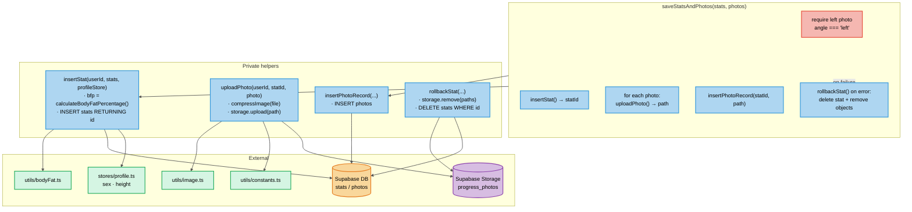
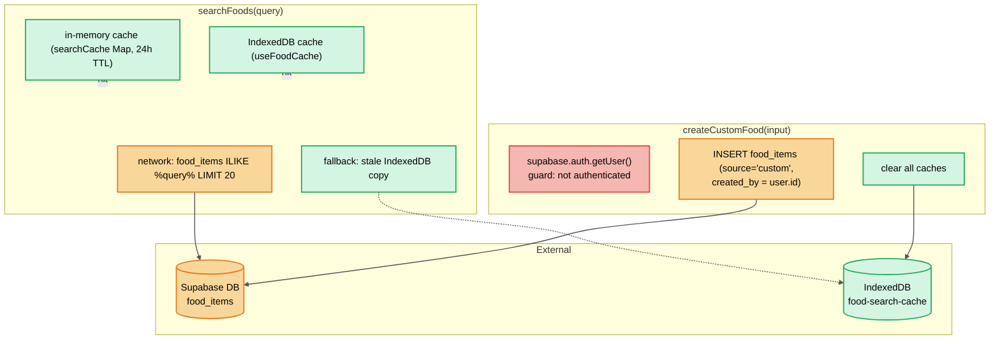
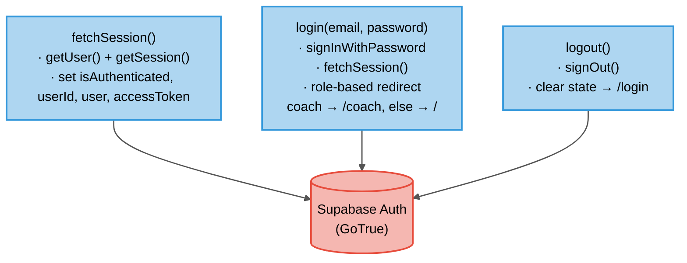
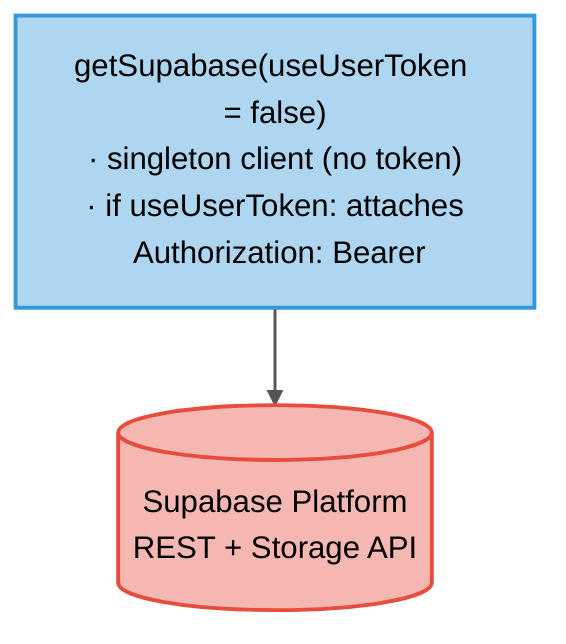

# C4 Level 4 — Code

Low-level detail for the most important stores and utilities. These are the files most likely to change (per `AGENTS.md` "Files to Watch").

## 4a. Stats store — `app/stores/stats.ts`



**State:** `stats[]`, `leftPhotoCheckins[]` (deduped by `stat_id`, signed URLs with 7-day expiry).
**Getters:** `weightChartData`, `waistChartData`, `bfpChartData` (sorted ascending by `created_at`).

---

## 4b. Diet plan store — `app/stores/dietPlan.ts` (mentee side)

```mermaid
flowchart TB
    classDef action fill:#aed6f1,stroke:#3498db,stroke-width:2px,color:#000
    classDef db fill:#f9d79b,stroke:#e67e22,stroke-width:2px,color:#000
    classDef state fill:#d5f5e3,stroke:#27ae60,stroke-width:2px,color:#000

    subgraph Mentee["Mentee actions"]
        M1["fetchPlanForDate(date)<br/>· diet_plans (start ≤ date ≤ end)<br/>· diet_plan_meals + items + food_items<br/>· fetchLogs(date)<br/>· fetchNotes(date)"]:::action
        M2["toggleConsumed(foodItemId, consumed)<br/>· upsert diet_plan_logs<br/>(onConflict mentee_id, food_item_id, log_date)"]:::action
        M3["saveNotes(date, notes)<br/>· upsert diet_plan_notes<br/>(onConflict mentee_id, diet_plan_id, log_date)"]:::action
    end

    subgraph State["Client state"]
        S1["currentPlan: DietPlanWithMeals\|null"]:::state
        S2["logs: Record<foodItemId, DietPlanLog>"]:::state
        S3["notes: Record<date, string>"]:::state
    end

    subgraph DB[("Supabase DB")]
        D1[("diet_plans")]
        D2[("diet_plan_meals")]
        D3[("diet_plan_food_items")]
        D4[("food_items")]
        D5[("diet_plan_logs")]
        D6[("diet_plan_notes")]
    end

    M1 --> D1 & D2 & D3 & D4
    M1 --> S1 & S2 & S3
    M2 --> D5
    M2 --> S2
    M3 --> D6
    M3 --> S3

    linkStyle default stroke-width:1.5px,fill:none,stroke:#555
```

**Key rule:** `diet_plans` is unique on `(mentee_id, start_date)` — one active plan per mentee per date. `diet_plan_logs` unique on `(mentee_id, food_item_id, log_date)`.

---

## 4c. Diet plan store — `app/stores/dietPlan.ts` (coach side)

```mermaid
flowchart TB
    classDef action fill:#aed6f1,stroke:#3498db,stroke-width:2px,color:#000
    classDef db fill:#f9d79b,stroke:#e67e22,stroke-width:2px,color:#000
    classDef guard fill:#f5b7b1,stroke:#e74c3c,stroke-width:2px,color:#000

    subgraph Coach["Coach actions (useSupabase(true) — user JWT)"]
        C1["fetchMentees()<br/>· profiles WHERE role='mentee' AND coach_id = me"]:::action
        C2["fetchCoachPlans()<br/>· diet_plans WHERE coach_id = me<br/>+ meals + items + food_items"]:::action
        C3["fetchPlanForEdit(planId)<br/>· WHERE coach_id = me"]:::action
        C4["createPlan(input)<br/>· Zod validation (planInputSchema)<br/>· INSERT diet_plans → planId<br/>· INSERT diet_plan_meals → mealIds<br/>· INSERT diet_plan_food_items<br/>· rollback on failure<br/>DELETE meals, DELETE plan"]:::action
        C5["updatePlan(planId, input)<br/>· UPDATE diet_plans (coach_id = me)<br/>· DELETE + re-INSERT meals + items"]:::action
        C6["deletePlan(planId)<br/>· DELETE diet_plans WHERE coach_id = me<br/>(cascades to meals, items, logs, notes)"]:::action
        C7["fetchPlansForMentee(menteeId)<br/>· lightweight list for date-range blocking"]:::action
    end

    subgraph DB[("Supabase DB (RLS: coach_id = auth.uid())")]
        DP[("diet_plans")]
        DM[("diet_plan_meals")]
        DFI[("diet_plan_food_items")]
        FI[("food_items")]
        P[("profiles")]
    end

    C1 --> P
    C2 & C3 & C4 & C5 & C6 & C7 --> DP
    C4 & C5 --> DM & DFI
    C4 & C5 --> FI

    linkStyle default stroke-width:1.5px,fill:none,stroke:#555
    linkStyle 4,5,6 stroke:#e67e22,stroke-width:2px
```

---

## 4d. Food item store — `app/stores/foodItem.ts`



---

## 4e. Auth store — `app/stores/auth.ts`



---

## 4f. Supabase client util — `app/utils/supabase.ts`



**Token strategy:** `useUserToken=true` is used for coach/mentee write operations (RLS evaluates `auth.uid()` from the JWT). `useUserToken=false` (anonymous) is used for public reads (`food_items`, `plans`).

---

## 4g. Body fat calculation — `app/utils/bodyFat.ts`

US Navy method, calculated **client-side** and stored in `stats.bfp`:

```
male:   86.01 × log10(waist − neck) − 70.041 × log10(height) + 36.76
female: 163.205 × log10(waist + hip − neck) − 97.684 × log10(height) − 78.387
```

- Throws if `height ≤ 0`.
- Throws if `waist ≤ neck` (male) or `waist + hip − neck ≤ 0` (female).
- Requires profile `sex` + `height` (both NOT NULL in `profiles`).

---

## 4h. Image compression — `app/utils/image.ts`

- `createImageBitmap` → canvas resize (max 1000px longest edge) → JPEG quality 0.82.
- Returns original file if compression doesn't reduce size or APIs unavailable.
- Used by `statsStore.uploadPhoto()` before `storage.upload()`.
